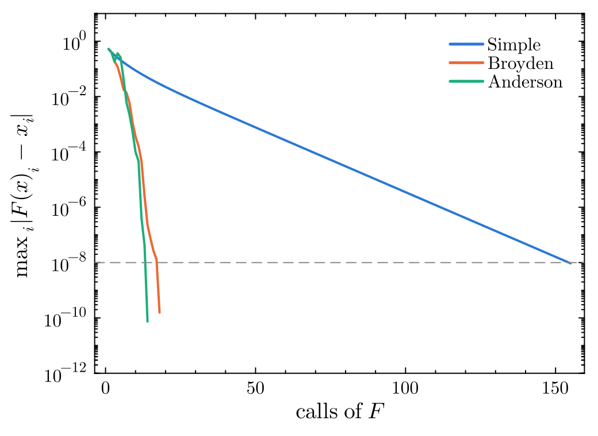
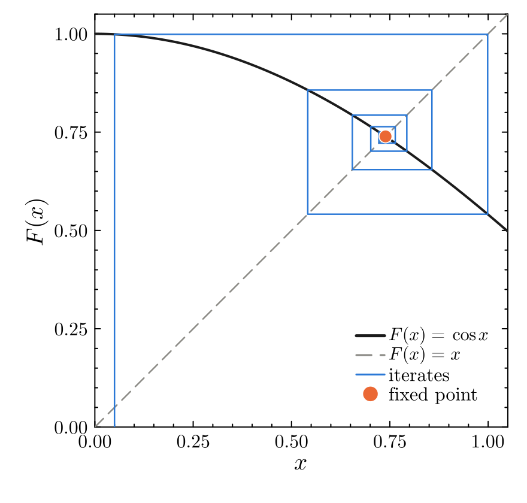
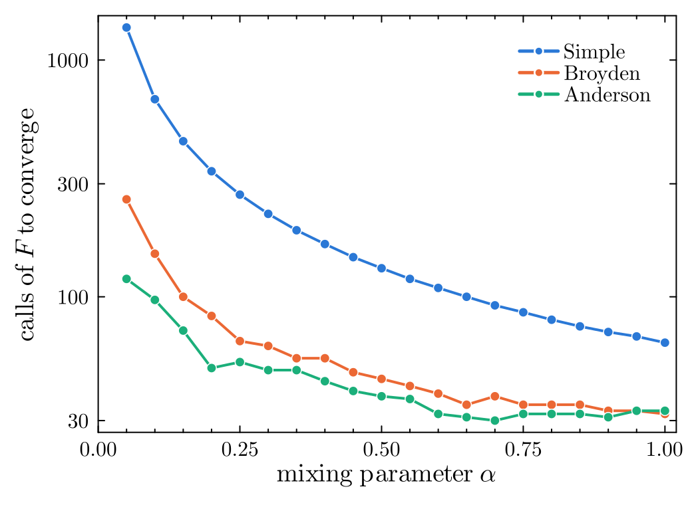
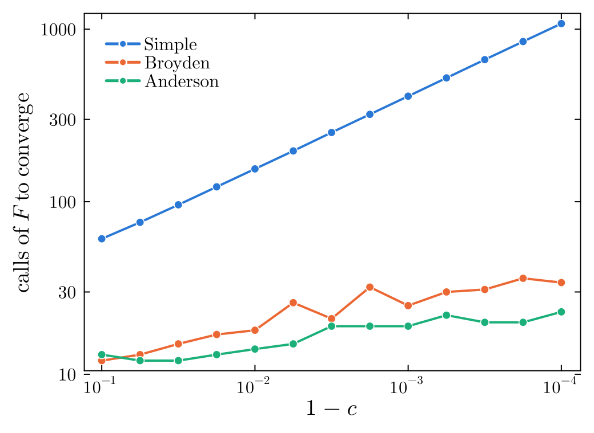

# FixedPointToolkit.jl

[](https://github.com/Toronto-Condensed-Matter-Theory/FixedPointToolkit.jl/actions/workflows/CI.yml?query=branch%3Amain)
[](https://Toronto-Condensed-Matter-Theory.github.io/FixedPointToolkit.jl/dev/)
[](LICENSE)

FixedPointToolkit.jl finds fixed points $x = F(x)$ of scalar and vector functions, real or complex.
Equivalently, it solves systems of self-consistent equations, such as the gap equations of mean-field theory.
It provides simple, scheduled, Broyden and Anderson mixing, checkpoints long runs to disk, and resumes them.

<p align="center">
  
</p>

## Installation

FixedPointToolkit is registered in the General registry.
In the Julia REPL, press `]` to enter package mode and run

```julia
add FixedPointToolkit
```

## Quick start

```julia
using FixedPointToolkit

# Solve x = F(x) for a small nonlinear system with fixed point (1, 1).
F(v) = [(v[1]^2 + v[2]^2 + 8) / 10, (v[1] * v[2]^2 + v[1] + 8) / 10]

sc = SelfCons(F, AndersonMixing, [0.2, 0.7]; Update_kwargs = Dict(:alpha => 0.5, :m => 5))
FixedPoint!(sc; tol = 1e-10, max_iter = 100)

sc.VIns[end]          # ≈ [1.0, 1.0]
length(sc.VIns)       # 9: the initial guess plus eight iterations
```

`SelfCons` stores the full history of inputs `sc.VIns` and outputs `sc.VOuts`.

## Features

* **Any function.** `F` can be scalar- or vector-valued, real or complex, and can take fixed arguments (`F_args`) and keyword arguments (`F_kwargs`).
* **Update methods:**
  * `SimpleMixing`: linear mixing of input and output with weight `alpha`.
  * `ScheduledMixing`: simple mixing whose weight changes with the iteration, through `QuadraticScheduling`, `ExponentialScheduling` or a user-defined scheduler.
  * `BroydenMixing`: quasi-Newton ("good" Broyden) updates. It stores a dense $N \times N$ matrix, so it suits problems with up to a few thousand unknowns.
  * `AndersonMixing`: Anderson (Pulay/DIIS) extrapolation from the last `m` iterations. It needs only $O(Nm)$ memory and is the default choice when `F` is expensive.
  * Custom update functions with the same signature.
* **Convergence criterion.** Iterations stop once every component satisfies $|F(x)_i - x_i| <$ `tol`.
* **Checkpointing.** `FixedPoint!(sc, "run.jld2")` saves the history to a JLD2 file every `checkpoint_interval` iterations, and `ContinueFixedPoint!` resumes a run from that file.
* **Plotting.** `Plot_History` plots the inputs, outputs or convergence against iteration. Plotting is a package extension, so run `using Plots` first.

## Gallery

<table>
  <tr>
    <td width="50%"><br><em>Residual against the number of calls of F for the Chandrasekhar H-equation (N = 100, c = 0.99). Broyden and Anderson mixing converge about ten times faster than simple mixing. The dashed line marks the tolerance.</em></td>
    <td width="50%"><br><em>Cobweb diagram of the iteration x → cos x (simple mixing with α = 1), spiralling in to the fixed point x* ≈ 0.739.</em></td>
  </tr>
  <tr>
    <td width="50%"><br><em>Cost of convergence against the mixing parameter α for a nonlinear map with both slow and oscillating modes (N = 60). Broyden and Anderson mixing depend much less on α than simple mixing.</em></td>
    <td width="50%"><br><em>Cost of convergence as the Chandrasekhar H-equation approaches its singular point c → 1. Simple mixing slows down roughly as 1/√(1 − c); Broyden and Anderson mixing barely notice.</em></td>
  </tr>
</table>

The figures are regenerated with `julia --project=docs/readme docs/readme/figures.jl`.

## Examples

The [`Sample`](Sample) folder contains:

* `ScalarFunction.jl` and `VectorFunction.jl`: minimal fixed-point problems solved with each update method.
* `MixingComparison.jl`: the number of calls of `F` each method needs on a set of standard test problems, with optional convergence plots (`--plot`).

Run it from the repository root:

```
julia --project=. -e 'using Pkg; Pkg.instantiate()'
julia --project=. Sample/MixingComparison.jl
```

## Documentation

For further details, see the [documentation](https://Toronto-Condensed-Matter-Theory.github.io/FixedPointToolkit.jl/dev/).

## Related packages

| Package | Purpose |
|:--|:--|
| [TightBindingToolkit.jl](https://github.com/Toronto-Condensed-Matter-Theory/TightBindingToolkit.jl) | Lattices, tight-binding and BdG Hamiltonians, band structures and response |
| [FixedPointToolkit.jl](https://github.com/Toronto-Condensed-Matter-Theory/FixedPointToolkit.jl) | Fixed-point iteration and mixing schemes for self-consistent equations |
| [MeanFieldToolkit.jl](https://github.com/Toronto-Condensed-Matter-Theory/MeanFieldToolkit.jl) | Self-consistent mean-field theory of interacting lattice models |
| [RPAToolkit.jl](https://github.com/Toronto-Condensed-Matter-Theory/RPAToolkit.jl) | Random phase approximation: instabilities and collective modes |
